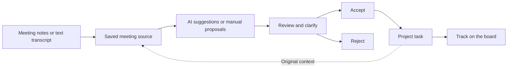

# TaskIQ

### From discussion to delivery.

TaskIQ is an AI-assisted project workspace that helps teams turn meeting notes into actionable work. It brings the original discussion, proposed tasks, human review, and project tracking into one place.

I built TaskIQ to address a familiar gap: a team agrees on work in a meeting, but turning that conversation into clear responsibilities and tracking it afterward still takes manual effort. TaskIQ makes that handoff explicit, with a source passage behind each meeting-derived task and a person deciding what reaches the project board.

## Why TaskIQ?

Meeting notes capture a conversation. A task board captures execution. The connection between them often disappears when someone copies an action item into a card.

TaskIQ keeps that connection. Teams can check what was said, clarify who owns the work and when it is due, and review AI suggestions before making them commitments.

## How it works

1. **Bring the team together.** Sign in with Google, create a private workspace, and invite teammates with Admin, Member, or Viewer access.
2. **Capture the discussion.** Save meeting notes or import a text transcript into a project. The saved source stays unchanged for future reference.
3. **Propose the work.** Generate task suggestions when AI is enabled, or draft proposals manually. Each proposal includes an exact passage from the source.
4. **Make the commitment clear.** Review the description, owner, deadline, and priority. Missing owners and unclear dates are flagged for clarification. Edit, accept, or reject each proposal.
5. **Follow through.** Accepted proposals become project tasks. Track progress in a list or Kanban board and return to the original source whenever context is needed.

## What TaskIQ offers

| Capability | What it helps the team do |
|---|---|
| Private workspaces and projects | Keep each team's work organized with controlled access |
| Invitations and workspace roles | Choose who can administer, contribute, or view |
| Meeting history and transcript imports | Retain the context behind project work |
| AI-assisted task proposals | Turn unstructured notes into candidate actions |
| Review before task creation | Decide which suggestions become commitments |
| Source evidence and review history | Trace accepted work back to its discussion and reviewer |
| Owners, priorities, deadlines, and status | Make responsibility and progress visible |
| List and Kanban views | Manage day-to-day execution |
| AI summaries, when enabled | Get an overview of the project's tasks |

Text transcript imports support `.txt`, `.md`, `.vtt`, and `.srt` files. Teams can also create tasks directly for work that does not originate in a meeting.

## An example

> “Aman will update the onboarding guide by Friday.”

TaskIQ can propose **Update the onboarding guide**, retain **Aman** as the named owner, and show the supporting sentence. **Friday** remains visible for clarification into a specific date. A reviewer can assign the appropriate teammate, set the date, and accept the proposal. The resulting task keeps its link to the meeting source.

An exact quote helps the reviewer verify context; it does not guarantee that every AI-generated field is correct. Human review is part of the workflow.

## What I built

TaskIQ combines a collaborative project application with a structured AI extraction and review pipeline.

- **Structured extraction:** meeting text is processed into typed task proposals, and every supporting quote is checked against the saved source before proposals are stored.
- **Human control:** generation and task creation are separate steps. Only explicit acceptance turns a meeting proposal into a board task.
- **Traceable decisions:** accepted tasks retain their source, proposal, reviewer, and review time.
- **Consistent reviews:** version checks detect stale edits, while transactional acceptance and uniqueness constraints guard against duplicate task creation.
- **Team access:** Google sign-in, server-side sessions, workspace membership, role checks, and member assignments support shared project work.
- **Verification:** automated checks cover access boundaries, proposal review, retries, concurrency, and schema migrations on SQLite and PostgreSQL, with browser checks for the main workflow.

The application uses **Python, FastAPI, Pydantic, SQLAlchemy, PostgreSQL, Google OAuth, and vanilla JavaScript**. AI extraction and summaries use the **Google Gemini API** when enabled.

## Current scope

The live release provides the workspace and task-management foundation. The meeting-source and proposal-review workflow is implemented in the next release and is awaiting release; live AI inference still needs verification before it is enabled.

Meeting input currently comes from pasted notes and text transcripts. Audio recording, transcription, and agents that join Zoom or Google Meet are future work. Updating existing tasks from follow-up meetings and mapping task dependencies are also planned extensions.

TaskIQ's direction is to preserve the connection between what a team discusses, what it commits to, and what it delivers.
