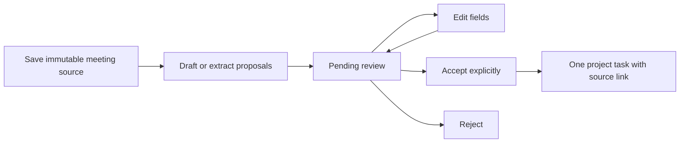

# Phase 2: meeting sources and reviewed task extraction

## Implemented workflow

Open **Meetings & review** inside a project. Save a title, meeting date, IANA timezone, and pasted notes or a transcript. UTF-8 `.txt`, `.md`, `.vtt`, and `.srt` files can be loaded into the source editor before saving. Files are decoded in the browser; the API receives bounded plain-text JSON. There is no multipart/binary upload or audio transcription in this phase.

Saving a meeting creates no tasks. The source becomes immutable. Generate AI suggestions if AI is enabled, or manually draft a proposal using an exact supporting passage. Every proposal starts Pending. Missing owners and non-ISO/invalid deadlines are flagged. Users can save edits, accept the edited proposal as a task, or reject it. Acceptance records the reviewer/time and links the task to the original meeting, proposal and verified source passage. The board's Source button opens that meeting and highlights the passage.



Admins and Members may save/review. Viewers can read meeting history, sources and proposals, but cannot save, extract, edit or review. Roles remain workspace-wide. Client-provided project, meeting and proposal combinations are checked on the backend.

## AI contract and evidence

The meeting extraction schema requires description, priority and an exact contiguous `source_quote`, with optional owner and deadline strings. The provider receives the meeting date/timezone as context, but must preserve deadline wording rather than guess absolute dates. Relative deadlines such as Friday are displayed for clarification. Missing owner/deadline fields remain empty. Reviewer corrections are explicit and can differ from what was originally discussed.

The backend validates the entire batch before saving proposals and verifies each source quote is an exact substring of the saved text. Evidence that cannot be located causes the batch to fail without partial proposal insertion. Quotes are limited to 2,000 characters; the first occurrence is highlighted if a passage repeats. Offsets are Unicode code-point indexes, and the UI converts the source to code points before highlighting. A matching quote is evidence for review, not proof that all generated fields are factually correct. Field accuracy still needs a labeled evaluation set and human review.

The new provider prompt treats meeting text as data rather than instructions and grants no tools/actions. No confidence percentages or model reasoning are exposed as reliability measures. Existing AI limits, timeout/backoff and quotas apply. Full live provider inference is not covered by mocked automated tests.

`GEMINI_MODEL` makes the provider model configurable; the prototype's `gemini-2.5-flash` default is retained for compatibility rather than silently changing cost/behavior. Before enabling AI, select an available model, check its pricing/structured-output support, and run a small authorized live extraction/summary check. Google's current [deprecation schedule](https://ai.google.dev/gemini-api/docs/deprecations) limits 2.5 Flash access to previous users and announces automatic rerouting from December 1, 2026. The offline SDK test validates serialization, not live model availability or quality.

The old `POST /api/projects/{project_id}/tasks/extract` returns 410 for authorized writers. It cannot create tasks or invoke the model, so old clients cannot bypass review. Manual task creation remains available independently for work without a meeting source.

## Retry and concurrency behavior

- Meeting saves and manual proposal creation require UUID request identifiers. Repeating the same payload/key returns the original record. Reusing the key for different content returns 409. The UI retains keys across request errors and generates a fresh key after form content changes.
- Extraction states are Draft, Extracting, Ready and Failed. Once Ready, retrying extraction returns the existing review set, including an empty successful result, rather than regenerating suggestions.
- An extraction attempt claims its state under the workspace lock and releases the DB transaction before calling the provider. Concurrent requests get 409 while it is running. After 120 seconds, a stale attempt can be retried or replaced with a manual proposal. Each completion checks the attempt number and state, preventing an old attempt from saving over newer work. Attempts are capped at ten per meeting, in addition to shared quotas.
- Failure retains the source and marks the attempt Failed. Membership is checked again before saving model proposals. Internal failure cleanup does not grant the former member access to the project.
- Proposal edits/reviews carry the version the reviewer saw. A stale version returns 409. The UI preserves other proposals' unsaved fields when one proposal is saved/reviewed. A refresh is explicit.
- Workspace-row locks serialize decisions on PostgreSQL. Accepting creates a task and saves the decision in one transaction. A unique task-to-proposal constraint is an additional duplicate-creation guard.
- An identical review replay by the same actor returns the original result; changed decisions or edits after review return 409. Deleting an accepted task does not erase the meeting/proposal and replaying acceptance does not recreate it.

This is still bounded synchronous inference, not a durable job queue. If a process dies, an Extracting source may need a lease-expiry retry. Phase 2 does not implement semantic duplicate detection across different meetings or approval of changes to existing tasks.

## Limits and source retention

- Up to 20,000 characters per source, within the existing 128 KiB JSON request-body limit.
- Browser transcript files up to 80 KB, subject to the same character cap and strict UTF-8 decoding. NUL bytes and unsupported filenames are rejected. Preview/edit the text before saving.
- Maximum 200 meeting records per project and 500 per workspace.
- Maximum 100 proposals per meeting; paginated history returns at most 50 meetings per request.
- There are no meeting/source edit or delete endpoints in this phase. This protects provenance, but the operator must handle retention/data-deletion requests. Do not promise a self-service deletion feature in privacy terms. A future deletion workflow must explicitly handle already-approved task provenance.

## Migrate and verify

```powershell
.\.venv\Scripts\python -m alembic upgrade head
.\.venv\Scripts\python -m alembic check
.\.venv\Scripts\python -m pytest -q
python scripts/browser_smoke.py
```

Migration `0002_meetings` adds meetings, proposals and an optional provenance link to existing tasks. Existing Phase 1 tasks stay unchanged and have no source link. Use the migration release procedure in SYSTEM_DESIGN.md; do not change the running production database until the matching code release is ready. Downgrade removes the Phase 2 sources/reviews and should not be used as a routine production rollback.

For local Windows PostgreSQL verification, start Docker Desktop and run `scripts/test_postgres.ps1`. It creates a labeled disposable PostgreSQL 16 container with a loopback-only random port, runs tests in isolated schemas, and removes the container. CI also runs the suite against PostgreSQL 16. Never point TASKIQ_TEST_DATABASE_URL at the production database.

Browser smoke checks cover transcript upload, source preservation, Unicode highlighting, editing/accepting a proposal, rejecting another, board provenance links, mobile layout, and logout. Provider calls remain disabled in that smoke test.

## API outline

| Method | Project-relative path | Purpose |
|---|---|---|
| POST | `/meetings` | Save immutable source with request UUID |
| GET | `/meetings` | Paginated meeting history and review counts |
| GET | `/meetings/{meeting_id}` | Read source, proposals and review state |
| POST | `/meetings/{meeting_id}/extract` | Generate pending proposals |
| POST | `/meetings/{meeting_id}/proposals` | Draft a pending proposal with exact quote |
| PATCH | `/meetings/{meeting_id}/proposals/{proposal_id}` | Version-checked draft edits |
| POST | `/meetings/{meeting_id}/proposals/{proposal_id}/review` | Versioned accept/reject with optional acceptance edits |

All paths are under `/api/projects/{project_id}` and require a valid session. Writes require the existing Origin and CSRF checks.

## Next phases

Audio transcription/meeting capture, comparisons against existing commitments, commitment history, client scope approvals, unresolved-commitment workflows and dependency impact remain separate future work. This phase provides the source/review foundation, not those features.
