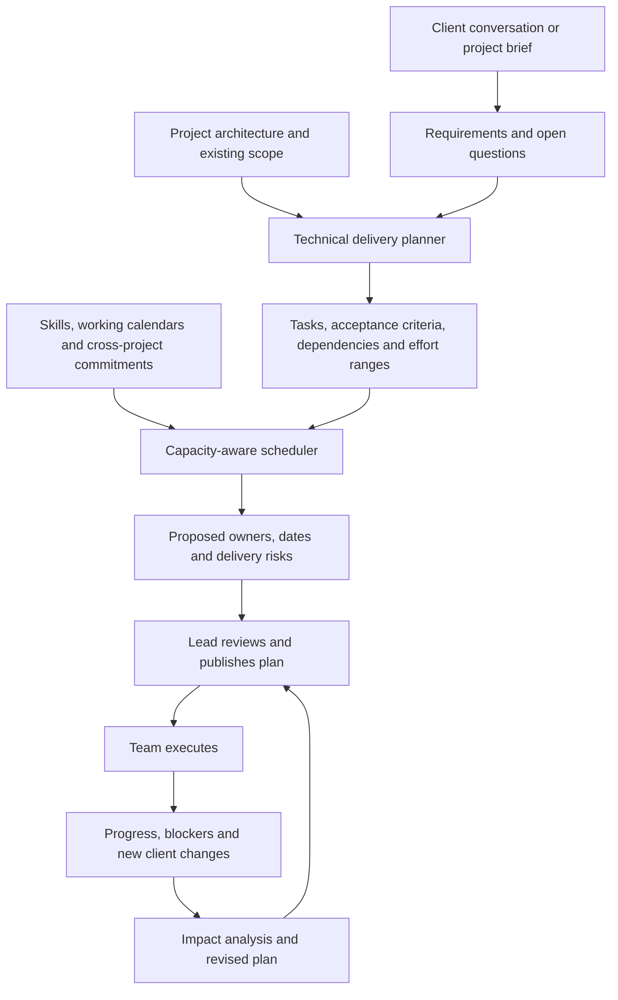

# TaskIQ product direction and phased delivery plan

Status: revised product plan. Phases 1–2 describe the existing foundation; Phases 3–7 are planned, not implemented or release promises. This plan supersedes the earlier transcript-first and informal phase proposals.

## Product promise

TaskIQ is an AI project manager with software-delivery reasoning: it turns client goals into a proposed implementation plan, matches work to a team's actual capacity, and revises that plan as requirements and progress change.

The primary user is the delivery lead managing software projects with a shared team. Clients describe desired outcomes; they should not need to name developers, describe API endpoints, or create implementation tickets. A lead signs in to answer: What must we build? What is unclear? Who can deliver it? Is the requested date realistic? What changed, and what needs a decision?

Meeting transcripts are an input channel. The product's output is a feasible, explainable delivery plan. The system does not autonomously implement production software in this roadmap.

## End-to-end experience

The main product surface becomes a project delivery overview: requirement coverage, plan, team allocation, blockers, milestones and decisions. The existing task board supports execution; meeting history provides evidence. Neither is the sole home of the product.

## Phase sequence

| Phase | Outcome | Status |
|---|---|---|
| 1. Workspace foundation | Identity, projects, roles, team membership and tasks | Existing live foundation |
| 2. Evidence and review foundation | Retained meeting text, source-linked proposals and explicit review | Implemented on review branch; release pending |
| 3. Project and team model | Enough context to plan real software work and measure capacity | Next implementation |
| 4. Requirements-to-delivery planner | A client request becomes a reviewable technical plan | First release of the new core value |
| 5A. Capacity-aware allocation | A reviewed plan gains feasible owner/date recommendations across projects | Planned |
| 5B. Connected meeting intake | Available meeting transcripts enter the right project automatically | Parallel integration track; feasibility-dependent |
| 6. Delivery monitoring and replanning | New information produces an explainable plan revision | Planned |
| 7. TaskIQ meeting participant | Our own agent attends supported meetings and supplies their content | Separate platform and operating-cost gate |

Phases 5A and 5B may proceed independently once their prerequisites are ready. Transcript integration discovery starts during Phase 3, rather than waiting until the planning engine is finished. Do not delay the core planner for a meeting bot or market manual transcript entry as the finished product.

## Phase 1 — Workspace foundation

Retain Google sign-in, private workspaces, projects, invitations, roles, member assignments and task tracking. These are infrastructure for shared delivery, rather than the product differentiator. Existing permissions and tenant isolation must hold for every new planning route.

## Phase 2 — Evidence and review foundation

Keep the implementation already built: immutable sources, exact source passages, pending proposals, edits, accept/reject, reviewer history and duplicate-acceptance protection. Release it as groundwork, not as completion of the AI project manager.

Important distinction for later phases: current proposals require an exact quote for an explicitly discussed action. A derived engineering task may never appear in the client's words. Do not invent a quote or force derived tasks through that contract. Add a separate plan-proposal model linked to requirements and explicitly labeled as derived work.

## Phase 3 — Project context and team capacity model

### Deliverables

- Project profile: client, intended users, goals, existing versus new product, known architecture/stack, constraints, target milestones and priority. Optional budget is a constraint only when actually supplied.
- Requirements: outcome, acceptance conditions, source, unresolved questions, assumptions, scope status and dependencies on other requirements. Distinguish a requested date from a team-approved commitment.
- Team profiles: role, skills, relevant experience, working calendar, timezone, leave and project allocations. Initially use declared skills and lead-validated experience; do not create opaque employee rankings.
- Work estimates: remaining effort ranges, estimate author/source, update time, dependencies and required skills. Existing tasks without estimates remain unknown work, not zero-effort work.
- Capacity view across projects inside the authorized workspace, with working-time reservations. Cross-workspace sharing is off by default and requires an explicit future organizational permission model.

### User experience

A lead creates a project brief and reviews a compact team setup. Members maintain availability and remaining effort. Missing context generates targeted questions instead of an invented plan. A role is a planning requirement; an actual teammate is assigned later.

### Exit gate

A lead can inspect a person's available time, existing project reservations and unknown workload for a selected date range. Leave, part-time work and multiple projects are represented without double counting. No new employee or project data leaks through allocation views.

## Phase 4 — AI requirements-to-delivery planner

### Deliverables

- Interpret client inputs into requirements, decisions, assumptions and clarification questions using the project context.
- Propose a feature breakdown into implementable tasks across the roles actually needed: frontend, backend, design, QA or release work. Do not create every role for every request.
- Include acceptance criteria, required skills, dependency links and effort ranges for each task. Separate explicit client statements from technical inferences.
- Detect coverage gaps: a requirement with no implementation work, work with no requirement, missing acceptance criteria and unresolved questions affecting feasibility.
- Present a versioned plan for lead review: approve groups of work, edit tasks, reject unnecessary work, or request a revision. Highlight high-impact assumptions rather than require repetitive acceptance of every small generated card.
- Publish an approved plan atomically. Failed generation or a retry must not publish half a plan or duplicate its tasks.

### Planning boundaries

Use staged, typed generation: requirements first, then technical breakdown using reviewed context. Validate references, dependency cycles and required fields in code. An LLM proposes engineering work and estimate ranges; it does not establish scope, security correctness or guaranteed completion dates. Important unresolved architecture questions remain visible and may block publication of affected work.

### Exit gate

On a lead-reviewed set of representative project briefs, inspect requirement coverage, unsupported assumptions, task usefulness, dependency validity and the amount of correction needed. Compare planning time with the lead's existing process. Set acceptance thresholds from a baseline before release; do not substitute an invented confidence percentage for evaluation.

## Phase 5A — Capacity-aware allocation and scheduling

### Deliverables

- Calculate eligible people from required skills, role fit, project access and declared availability. Report missing skills and unknown capacity explicitly.
- Schedule against working calendars, leave, existing cross-project reservations, task dependencies and milestone constraints. Estimate ranges produce delivery scenarios, not one falsely precise completion date.
- Recommend an owner and planned time window, with alternatives and an explanation. Prefer fit and feasibility before secondary preferences such as continuity or workload balance.
- Let the lead compare scope reduction, reassignment, staffing or deadline changes when the requested plan cannot fit.
- Reserve capacity only when an allocation is approved. Recheck capacity and plan versions at publication so two simultaneous approvals cannot reserve the same time twice. Keep locked commitments stable unless a proposed revision is approved.

### Example

A frontend task has an estimated 12–16 hours of work before Friday. X has 6 free hours and Y has 18 free hours in that window. If Y has the required skills, project access and a usable start date after prerequisites, recommend Y. Show the reservations and assumptions behind the calculation. If a prerequisite finishes too late, flag the deadline even though Y has enough total hours.

Task counts do not measure workload. Completed work, missing estimates and stale progress updates need different treatment. Do not automatically move an existing assignment merely because another person's load changed.

### Technical approach and exit gate

Use deterministic scheduling and constraint checks for allocation. The LLM can explain results; it must not invent availability or override constraints. Start with a transparent heuristic and identify it as such, rather than claim an optimal solution. Consider a constraint solver only when measured cases require one.

Verify dependency order, calendar boundaries, skill eligibility, allocation conflicts and concurrent publication. Infeasible input must produce a visible shortfall. Missing workload data must prevent a confident feasibility claim.

## Phase 5B — Connected meeting intake

### Deliverables

- Connect an authorized meeting account separately from Google sign-in and associate selected meetings or a recurring series with a project. Ask when project mapping is ambiguous.
- Retrieve available transcripts using supported platform interfaces, then process them through requirements and change review. No external meeting-bot service is required by the design.
- Show intake state: waiting for transcript, ready, processing, failed, unavailable or needs project selection. Missing transcripts must not silently look like successful ingestion.
- Deduplicate external meetings/transcript revisions, handle delayed availability, support retry and revocation, and retain attribution to the original source.
- Provide background jobs, bounded retries, provider rate limits, encrypted integration credentials, deletion/retention controls and sanitized operational metrics.

### Feasibility and exit gate

Choose one platform first after checking its current transcript availability, account/host permissions, organizational controls, approval requirements and costs with real test accounts. No promise that all Zoom or Google Meet meetings have retrievable transcripts. Validate supported and unsupported account cases and revoked permissions before offering the integration publicly.

Once connected and mapped, the routine workflow should be meeting completion → draft requirement/plan changes ready for the lead. Pasting a transcript remains a fallback rather than recurring user work.

## Phase 6 — Delivery monitoring and controlled replanning

### Deliverables

- Compare new client requirements and progress updates with the approved plan. Propose new work, changed acceptance criteria, completion, reopening or removal without silently overwriting commitments.
- Track actual progress, remaining effort, blocked dependencies and stale updates. Explain schedule risk using recorded data; do not claim prediction accuracy before it is measured.
- Show the impact of a scope change on affected tasks, people, project reservations and milestones, including other projects affected by shared capacity.
- Generate a versioned proposed revision with before/after differences and reasons. Distinguish client scope approval from internal engineering/allocation approval; record the accountable approver for each.
- After approval, apply the revision atomically and preserve the earlier commitment history. Prepare concise status reports and specific questions requiring action.

### Exit gate

A late requirement or delayed dependency can be traced to its affected tasks and milestones. The proposed revision neither loses completed work nor silently steals another project's reserved capacity. Conflicting approvals require recalculation. Reports distinguish observed facts, assumptions and unresolved risks.

## Phase 7 — Our own TaskIQ meeting participant

Goal: a clearly identified TaskIQ participant can join supported client meetings and feed the same requirements/planning engine without a third-party meeting-bot vendor.

This is a separate product capability from retrieving a platform-generated transcript. Begin with a time-boxed feasibility prototype for one platform using an approved integration path. Verify platform permissions, host admission, participant notice, recording/transcription controls, service reliability and operating costs before committing to a release. Do not treat unattended browser automation as a proven production integration.

If feasible, build meeting scheduling/join lifecycle, capture, transcription, speaker attribution where supportable, processing jobs, failure recovery, storage and retention controls. Explicitly support meetings the agent cannot join or capture. Do not promise perfect diarization or attendance at every meeting.

If the platform or cost gate fails, continue supported transcript import and disclose the limitation. A bot feasibility failure must not block the core project-management product.

## Core data and system design

Use the existing PostgreSQL modular monolith for project data. Add explicit entities and foreign-key relationships; a graph database is not required.

| Entity | Responsibility |
|---|---|
| ProjectProfile | Goals, architecture, constraints and intended outcomes |
| Requirement / SourceLink | Requested behavior, acceptance conditions and provenance |
| Clarification / Decision / Assumption | What is unknown, approved or inferred |
| PlanVersion / PlanItem | Proposed versus approved scope, derived work and revisions |
| TaskDependency | Prerequisites with cycle validation |
| Skill / MemberSkill | Eligibility and declared expertise |
| WorkCalendar / TimeOff | Available working windows |
| EffortEstimate / ProgressUpdate | Estimate ranges, remaining work and freshness |
| CapacityReservation | Approved person/project/time allocation |
| Milestone / PlanApproval | Delivery outcomes and accountable commitments |
| IntegrationConnection / ExternalMeeting / IntakeJob | Authorized automated inputs and processing state |

Planning and integration jobs need durable background execution, persisted progress, cancellation, bounded cost and retry-safe publication. Release database transactions during model/network calls; validate versions and authorization again before saving results. Keep source evidence, derived engineering rationale and approval history distinct. Avoid storing model chain-of-thought; retain concise user-facing reasons and assumptions.

Maintain project scope visibility when showing cross-project load: a person may be known to be busy without revealing another client's confidential task descriptions. Audit plan publication, allocation changes, integration access and approvals. Extend retention/deletion beyond today's immutable-source limitation before connected meeting intake is publicly released.

## Product success measures

Measure whether a delivery lead gets a useful plan faster, how much of the generated breakdown survives review, whether critical requirement gaps are caught, and whether allocation suggestions obey real constraints. Track unplanned overload, plan revision effort, stale workload data, integration failures, processing time and cost per project workflow. Deadline adherence is an outcome to measure with context, not an AI guarantee.

## Immediate implementation boundary

Start Phase 3 with project profiles, team skills/calendars, remaining effort and a cross-project capacity view. Then deliver one complete Phase 4 scenario: a client feature request becomes a requirement-linked technical plan with acceptance criteria, role requirements, dependencies and estimate ranges for lead approval. Conduct meeting-integration feasibility discovery alongside this work.

Do not start with autonomous coding, employee scoring, a general-purpose chat assistant or a meeting bot as the main product. The first meaningful product milestone is a delivery lead approving a useful engineering plan; the next is approving a feasible team allocation.
