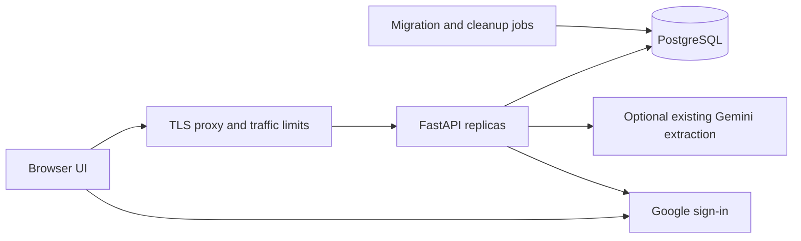

# TaskIQ: system design and launch runbook

Product direction and future phase order are defined in [the revised product roadmap](PRODUCT_ROADMAP.md). This runbook describes the current implementation; future planning, capacity allocation and meeting integrations are not implemented by the existing extraction workflow.

## Architecture

Use a same-origin modular monolith. FastAPI serves the static UI and API; PostgreSQL stores identity, memberships, projects, tasks, sessions, invitations, OAuth flows, quotas, immutable meeting sources and reviewed proposals. Google verifies identity; TaskIQ enforces authorization. No microservices or recording pipeline is required for Phases 1–2.

Future audio capture should use object storage and background workers, rather than large uploads to this JSON API.

## Ownership and permissions

- Google `sub` identifies users; signature, issuer, audience, expiry, nonce and verified email are checked. Email collisions fail closed rather than silently linking identities.
- Membership is keyed by workspace and user. Roles apply to all projects in a workspace. Every task route checks membership and queries using project plus task ID. An inaccessible project/workspace returns 404.
- Task writes and team administration lock the workspace row on PostgreSQL. This protects assignment integrity and the last Admin. Short writes are intentionally serialized per workspace, a future contention point for very large teams.
- Invites use random 256-bit secrets stored as hashes, expire after seven days, require the matching verified email and are consumed once. Fragments keep secrets out of server access logs. The browser holds a pending invitation in sessionStorage across sign-in and clears it on acceptance/dismissal.
- Member removal clears assignments and revokes access. AI writes recheck membership after provider work. Legacy public tasks require explicit operator import into a known Admin's empty project.

This is application-enforced tenant isolation, not PostgreSQL row-level security. New endpoints must use the same guards and isolation tests.

## Session and browser security

Login uses authorization code + browser-bound state + nonce + PKCE S256. A flow is consumed before exchanging the code. Google access/refresh tokens are not stored. Each successful login rotates a random opaque session, stored only as a hash. Sessions have a seven-day absolute expiry; logout deletes the current session, logout-all deletes all user sessions.

Production cookies use Secure, HttpOnly, SameSite=Lax and the __Host- prefix, with no Domain. Writes require an exact Origin match and a session-bound CSRF header. Session tokens are never stored in localStorage. API responses are no-store. OAuth and certificate fetches have bounded network timeouts.

Task/member/summary text uses textContent instead of HTML. CSP restricts scripts, styles, connections and framing. CSV cells are quoted and common formula prefixes neutralized. Errors and application logs omit provider secrets, query strings, bodies, cookies and email addresses.

Sources: [Google OIDC](https://developers.google.com/identity/openid-connect/openid-connect), [OWASP sessions](https://cheatsheetseries.owasp.org/cheatsheets/Session_Management_Cheat_Sheet), [OWASP CSRF](https://cheatsheetseries.owasp.org/cheatsheets/Cross-Site_Request_Forgery_Prevention_Cheat_Sheet.html).

## Resource bounds

| Resource | Implemented bound |
|---|---|
| JSON body | 128 KiB, including chunked requests, before parsing |
| Extraction | 20,000 input characters; 100 validated tasks; 8,192 output tokens per attempt |
| Task listing | Cursor pagination, default/max 100 tasks |
| Summary | Rejects projects above 500 tasks; 1,024 output tokens |
| Mutations | 60 per user per fixed minute |
| Login starts | 20 per socket-source IP per fixed minute |
| AI calls | 5 per user per minute; 100 per workspace per UTC day |
| AI concurrency | Two calls per process; immediate 429 when full |
| Database pool | Five connections + five overflow per process; ten-second wait |
| PostgreSQL | Fifteen-second statement timeout; ten-second connection timeout |
| Gemini | Twenty-second requests; maximum three extraction attempts plus bounded backoff |

Quota upserts are atomic and shared across workers. Fixed windows permit boundary bursts; quotas are not billing entitlements. Failed operations still consume budget. The AI semaphore is process-local: two workers allow four concurrent calls; four such replicas allow sixteen. Define the aggregate worker/replica budget before enabling AI publicly.

Database transactions are released during provider requests. AI is bounded synchronous work, not a durable queue. Phase 2 retains the source, records extraction state and permits recovery of stale attempts; extraction retries do not regenerate a completed review set. Task creation requires explicit, versioned review and is guarded against replay duplicates. Cross-meeting semantic duplicates are not detected. Background jobs remain future work. See PHASE2.md for the exact concurrency and retention contract.

PostgreSQL is required for public deployments; SQLite is development-only. Pool pre-ping handles stale pooled connections, not transaction retries. Indexed membership checks and project task keyset pagination avoid full-board and OFFSET scans. Four replicas of two processes can consume 80 DB connections before operators/migrations; size the database or pooler accordingly. This is connection arithmetic, not measured traffic capacity. [SQLAlchemy pooling](https://docs.sqlalchemy.org/en/20/core/pooling.html)

## Edge requirements

Enforce header/body/idle timeouts, maximum request size, concurrent connection limits, per-client login throttling and general API IP limits at the TLS proxy. The app's login limit uses the socket peer: behind a proxy with forwarding disabled, users share its quota. Configure trusted proxy addresses explicitly if forwarding client IPs, and restrict direct app access to that proxy. Never trust forwarded IP headers from arbitrary clients. The container defaults to proxy headers disabled.

Disable/sanitize callback query-string logging at the proxy. Pass request IDs through logs. Health probes must send the configured canonical Host header when reaching the app through an internal address.

## Launch gates

1. Provision staging PostgreSQL with least-privilege application access, private networking where available and TLS verification. Store secrets outside the repo/image. Prefer separate migration credentials when supported.
2. Set APP_ENV=production, canonical HTTPS APP_URL, PostgreSQL DATABASE_URL, Google OAuth credentials and initially AI_ENABLED=false. Register the exact callback and configure/publish the consent screen for the intended audience. Production startup rejects unsafe defaults.
3. Back up existing data, run `alembic upgrade head` once as a release job, verify revision/readiness, then switch traffic. Do not run concurrent migrations from workers or blindly downgrade a live database.
4. Deploy behind the configured TLS proxy with restricted app access. Start with two workers, enforce concurrency/connection limits, and schedule hourly `python manage.py cleanup`.
5. Complete real Google login/logout and invite acceptance using two independent accounts. Test Viewer writes and foreign workspace/task IDs through direct API calls.
6. Run the suite on PostgreSQL 16 and test concurrent role changes/invite acceptance. SQLite tests do not prove PostgreSQL lock behavior. CI is supplied but must be executed in your repository/runner.
7. Configure encrypted backups/retention and complete a restore drill. Agree on recovery time and data-loss targets; an untested backup is unverified.
8. Configure latency/error/readiness dashboards, DB pool/lock metrics, 429/login-failure alerts, and provider-spend alerts if AI is enabled. Logs include request ID, method, status and duration; collect sanitized path metrics at the edge.
9. Load-test staging. Suggested initial gates to validate: 25 concurrent interactive users, p95 reads below 500 ms/writes below one second excluding Google/AI, under 1% unexpected errors, and no pool exhaustion or isolation failures. These are targets, not achieved capacity claims. Scale gradually from measured results.
10. Start with a small invited cohort. Broaden access after real OAuth, PostgreSQL checks, restore drill and load gates pass. AI needs a separate cost/concurrency review.

## Failure handling

| Failure | Behavior / action |
|---|---|
| Invalid production config or missing schema | Startup refuses traffic; correct settings/apply migration |
| Database outage | Readiness 503; bounded connection/pool errors; generic API error with request ID |
| Google outage/invalid identity | No new session; retry using a fresh login flow |
| Removed member | Subsequent authorization denied; in-progress AI rechecks before saving |
| Leaked invite/session | Revoke invite or sign out all sessions; stored hashes alone cannot authenticate |
| Provider quota/saturation | 429 and Retry-After; no unbounded provider queue |
| Invalid model output / unlocatable evidence | Retain source, reject entire batch, mark extraction Failed; no tasks created |
| Interrupted extraction or client retry | Retained source and extraction lease allow retry; completed review sets and acceptance are replay-safe; durable jobs remain future work |

## Scope and remaining work

Phase 1 covers accounts/profiles, sessions, workspaces/projects, roles/invitations, member assignments, task CRUD and deployment foundations. Phase 2 adds immutable meeting text, transcript imports, source quotes, proposal editing and explicit accept/reject decisions with reviewer/time and version checks. It does not include meeting bots/audio capture, source-transcript editing, general audit event storage, account self-deletion/export, enterprise SSO, billing, per-project ACLs, task-edit conflict detection or durable jobs. Proposal versions protect review edits, not subsequent board-task edits. Document an operator-assisted data deletion process before promising it in a public privacy policy. Public terms/privacy and AI disclosures must match actual operation.

The revised sequence is project/team context → requirements-to-delivery planning → capacity-aware allocation and connected meeting intake → delivery monitoring/replanning → a separately validated TaskIQ meeting participant. See [PRODUCT_ROADMAP.md](PRODUCT_ROADMAP.md) for deliverables and release gates. This supersedes the earlier change-review-first sequence.

## Later roadmap: Google Workspace project agent

Status: optional context-source expansion, separate from the core delivery-planning roadmap. Evaluate selected email/document context only when core planning needs it. Automatic meeting intake and a joining meeting participant have their own explicit phases in PRODUCT_ROADMAP.md. This section is not a committed release promise.

Goal: let users select project-related Google emails, documents and calendar events, then have TaskIQ propose evidence-backed changes to existing project commitments.

Candidate features, in evaluation order:

1. Read selected Gmail threads and Google Docs to identify commitments, decisions, missing owners and conflicting deadlines. Present proposed task changes with source links for approval.
2. Prepare meeting agendas from an authorized Calendar event and selected project context.
3. Draft follow-up messages and scheduling changes. Require explicit approval of the exact recipients, content and event details before sending messages or modifying calendars.

Feasibility checkpoint before implementation: recheck Google's current agent-client rules, REST/MCP availability, minimum OAuth scopes, verification requirements, organizational access restrictions, data handling obligations and operating costs. Validate one read-only project-context workflow with test accounts before committing to wider support.

Use a separate OAuth client designated for AI-powered agents where Google's current integration requirements call for it. Keep the existing human sign-in client separate. The checkbox grants no additional permissions and does not enable meeting attendance. Any Google data connection must be optional, separately consented, scoped to the authorized user and project, and revocable. Treat retrieved documents and emails as untrusted input, not instructions authorizing tool execution. Provide access isolation, action history, token protection and retention controls before release.

Reference for later review: [Google OAuth clients for AI agents](https://support.google.com/cloud/answer/15549257?hl=en).
